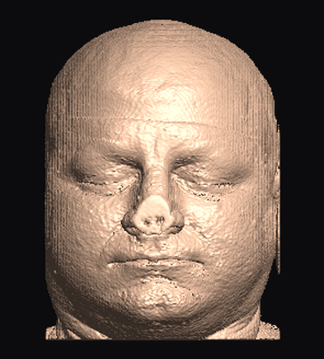
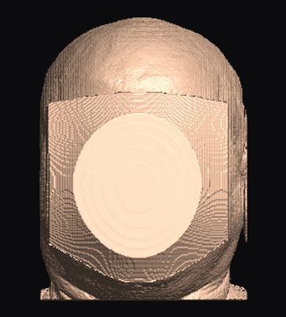
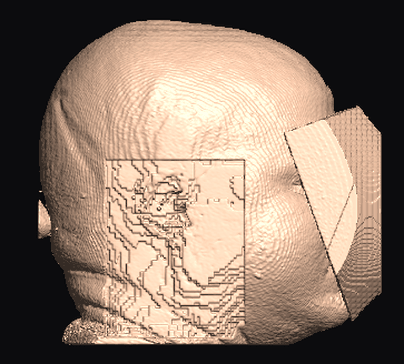
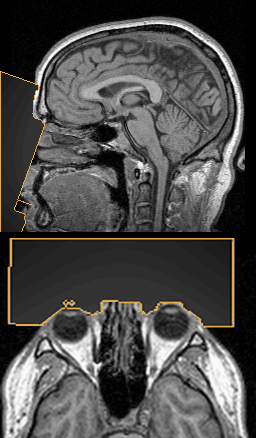
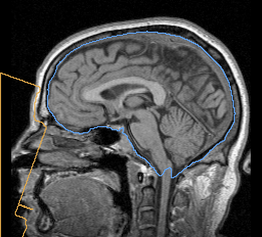

<h1 align="center">RadVeil</h1>

<p align="center">
  <b>Fast, verified face and ear anonymization for volumetric head imaging.</b><br>
  MRI and CT · NIfTI / DICOM / raw arrays · Rust core, Python API, C bindings, CLI
</p>

<p align="center">
  <a href="https://github.com/rAum/radveil/actions/workflows/ci.yml"></a>
    <a href="https://github.com/rAum/radveil/actions/workflows/release.yml"></a>
  <a href="https://pypi.org/project/radveil/"></a>
  <a href="https://crates.io/crates/radveil-core"></a>
  <a href="https://doi.org/10.5281/zenodo.23637315"></a>
  <a href="LICENSE"></a>
</p>

<p align="center">
  <a href="https://rAum.github.io/radveil/">Website</a> ·
  <a href="https://rAum.github.io/radveil/docs.html">Documentation</a> ·
  <a href="https://rAum.github.io/radveil/demo/">Browser demo</a> ·
  <a href="docs/quickstart.md">Quickstart</a> ·
  <a href="docs/examples.md">Examples</a> ·
  <a href="docs/legal.md">Legal notes</a>
</p>

<p align="center">
  
  
  
  
  
  <br><sub>3D Slicer's public "MRHead" sample: input · <code>adaptive</code> · face + ears (ears cut) ·
  the voxels that changed · the region (amber) vs the extracted brain (blue), 5 mm apart.</sub>
</p>

RadVeil finds the face the way an attacker would — by rendering the volume
as a 3D portrait and running a face detector on it — removes it, and
**accepts the result only when the detector fails on the output**. Ears are
removed on request and located by *measuring* the surface, not by assuming
an offset. Every voxel outside the anonymized region is preserved
**bit-exact**: same datatype, same scaling, same header.

> [!WARNING]
> **Early release (0.1), limited validation.** RadVeil has been tested on a
> small set of public scans only: the SynthStrip evaluation set, IXI
> subjects and 3D Slicer sample data. It is a de-identification *aid*, not a
> medical device and not a complete de-identification process.
> **Review every output before sharing data.**

## Quick start

```bash
pip install radveil                        # prebuilt wheels, no model download, no compiler
cargo install radveil-cli                  # or: the single-binary CLI
```

```python
import radveil

report = radveil.deface_auto("t1.nii.gz", "t1_defaced.nii.gz", mode="adaptive")
# {'views_detected': 3, 'residual_detections': 0, 'eye_dist_mm': 63.1, ...}

# the pinna is biometric too — opt in (face-only remains the default)
report = radveil.deface_auto("t1.nii.gz", "t1_defaced.nii.gz",
                             region="face+ears", mode="adaptive", ear_mode="cut")
# rois: [{'label': 'ear_left', 'detected': True, 'protrusion_mm': 14.0}, ...]
```

```bash
radveil auto t1.nii.gz t1_defaced.nii.gz --report report.json
```

The face detector is built in: the MediaPipe BlazeFace and Face Mesh
models (Apache-2.0) are embedded in the library and run by RadVeil's own
small pure-Rust SIMD inference engine. There is no ML framework, Bazel or
TensorFlow in the build, and no Python is needed for the CLI or C API.
[dlib](http://dlib.net) is available in Python as an optional second
detector or fallback (`fallback_detector="dlib"`); either way, the output
is verified against the built-in detector too.

## Why RadVeil

- **Attacker-model localization** — no atlas, no registration. A 2D face
  detector on CPU-rendered surface views pinpoints the face, and per-pixel
  position maps lift the 2D landmarks into scanner space. Detections must
  agree in 3D across views (*shape consensus*) before anything is modified.
- **Closed-loop verification** — the output is re-rendered and re-attacked
  from the detection views and a grid around them (`verify_effort`:
  `fast`, `balanced`, `thorough`). Blur escalates, and an opaque fill
  guarantees termination. If no plausible face exists (non-head data,
  already-defaced scans, a "face" on a field-of-view cut) it **refuses
  loudly** instead of modifying anything.
- **Skin-deep and auditable** — the face region follows the measured skin
  (~4.5 mm deep, `skin_depth_mm`, chosen to stay above the skull). Only
  voxels inside the exported binary mask change.
- **Brain-aware** — on the public SynthStrip evaluation set (201 scans
  processed, the rest refused) the face region touched the expert brain
  mask on none; median clearance 6.6 mm. The opt-in **brain guard**
  (`brain_guard=True`, `--brain-guard`) never modifies the brain or
  anything within 3 mm of it.
- **Zero tuning** — geometric parameters auto-scale from the detected
  inter-eye distance; works across sequences, resolutions, storage
  orientations (LPS/RAS/oblique/wrong affines), head sizes, MRI and CT.
- **Fast, CPU-only** — ~0.3 s per volume in a warm process, ~11 volumes/s
  batched on a laptop CPU ([deployment](docs/deployment.md),
  [performance](docs/performance.md)). SIMD kernels with runtime dispatch
  and a portable fallback.

## Modes and regions

| mode | effect |
|---|---|
| `adaptive` (recommended) | gradient-weighted averaging — the stronger a facial feature, the heavier the local kernel |
| `blur` | Gaussian blur of the region |
| `cut` | remove (fill with background: 0 on MRI, air on CT) |
| `block` | opaque slab (also the guaranteed final escalation step) |

| region | effect |
|---|---|
| `face` (default) | face-aligned ROI, depth-anchored to the measured eye-skin surface |
| `ears` | both pinnae, located by surface-protrusion detection |
| `face+ears` | both; `ear_mode` can pick a different mode for the ears (e.g. `adaptive` face, `cut` ears) |

The ear is a stable biometric identifier that survives most defacers, but
no landmark model emits ear points. RadVeil ray-marches the volume into a
surface height map, derives the scalp baseline by morphological opening,
and detects each pinna as a protrusion blob of the right shape and
position. Every ear ROI reports `detected` and `protrusion_mm`; an ear
outside the field of view is flagged, never silently missed.

Opt-in refinements (all off by default):

| option | what it does |
|---|---|
| `level_face` | measures the face skin along the level head axes, removing much more of the lower lip and chin |
| `spare_air` | leaves background air bit-exact, roughly halving the changed volume |
| `auto_threshold` | retries noisy, dim scans (e.g. infant T1s) at higher surface thresholds |
| `partial_face` | handles axial slabs that cut through the face (no mouth in the field of view) |

Details, measurements and every knob: [parameters & tuning](docs/parameters.md).

## Interfaces

- **Python** — `deface_auto` (file → file), `deface_volume` (in memory:
  DICOM series via any reader, raw arrays via `Volume.from_array`, uploads
  via `Volume.from_bytes` / `to_bytes`), `deface_batch` (multi-threaded
  cohorts), plus a step-by-step API (`render` / `detect_landmarks` /
  `lift_landmarks` / `Volume.deface`). `anonymization_mask` returns the
  region without modifying anything, for callers who process it themselves.
- **CLI** — `radveil auto` (one step, `--report` JSON), `radveil deskull`
  (brain extraction), `radveil conform`, plus `info | render | deface`.
- **C** — `libradveil` + [`radveil.h`](crates/radveil-capi/include/radveil.h):
  `radveil_deface_auto`, `radveil_anonymization_mask`, `radveil_deskull`,
  and the low-level load / render / deface / save calls.
- **Bring your own detector** — any callable returning 68 landmarks
  (`detector=f(rgb, try_rotations)`).

## Brain extraction

`radveil deskull` / `radveil.deskull()` / `radveil_deskull()` write a
binary brain mask, the skull-stripped volume, or both:

```bash
radveil deskull t1.nii.gz -o t1_brain.nii.gz --mask-out brain_mask.nii.gz
```

- **`synthstrip`** (default) — the [SynthStrip](https://synthstrip.io)
  network (Hoopes et al., NeuroImage 2022) reimplemented in pure Rust with
  embedded weights (MIT). Works on any MRI contrast, CT and PET. Masks
  match the reference `mri_synthstrip` at Dice 0.992–1.000, in ~3.5 s on a
  1 mm 256³ MPRAGE on a laptop CPU.
- **`classical`** — model-free; a BET-style deformable surface for MRI
  (optionally anchored by the detected face), bone-enclosed soft tissue for CT.
- **`rvbrain`** — experimental; loads your own smaller `.rvb` network
  (format in [`rvbrain.rs`](crates/radveil-core/src/rvbrain.rs)). No
  trained weights ship yet.

| Method (SynthStrip eval set, mean Dice) | All | Worst contrast |
|---|---|---|
| `synthstrip` | **0.969** | 0.955 (QIN T2) |
| `classical --face` (466 held-out) | 0.798 | 0.298 (qT1) |
| `classical` (466 held-out) | 0.682 | 0.298 (qT1) |

`radveil auto --brain-check` reports how many brain voxels the
anonymization touched and how close it came; the CLI exits with status 3
if any were modified, so a batch can stop on it.

If you publish results from the `synthstrip` method, please cite Hoopes
et al., NeuroImage 260 (2022) 119474.

## Guarantees and limits

- Voxels outside the mask are bit-identical to the input (tested in CI on
  synthetic phantoms).
- Output keeps the input datatype, `scl_slope` / `scl_inter`, affine and
  header. Header **metadata is deliberately not scrubbed** — that is your
  de-identification pipeline's job ([legal notes](docs/legal.md)).
- Verification demonstrates resistance to the embedded detector class,
  not to every conceivable attack; the exported mask supports independent
  audit.
- 3D volumes only (split 4D series first). CT is validated on synthetic
  Hounsfield phantoms; multi-subject CT evaluation is pending.

## Building from source

```bash
cargo build --release                                   # core + CLI (+ C lib: -p radveil-capi)
pip install maturin && maturin develop --release        # Python module
cargo test --workspace --release && pytest tests/       # phantoms only, no data needed
```

Releases are automated from version tags: wheels, the CLI and the C library
for Linux, macOS and Windows, with SBOMs and checksums
([release.yml](.github/workflows/release.yml), [RELEASING.md](RELEASING.md),
[SBOM](docs/sbom.md)). Contributions are welcome — see
[CONTRIBUTING.md](CONTRIBUTING.md); report vulnerabilities via
[SECURITY.md](SECURITY.md).

## Citing

If RadVeil is part of your anonymization pipeline, please cite it — it
makes your de-identification reproducible.

```bibtex
@software{radveil,
  author  = {Gródek, Piotr},
  title   = {{RadVeil: CPU-only face and ear anonymization for volumetric head imaging}},
  url     = {https://github.com/rAum/radveil},
  version = {0.1.1},
  year    = {2026}
}
```

A methods sentence you can adapt: *"Facial and auricular surfaces were
removed with RadVeil v0.1.1 (`region="face+ears"`, `mode="adaptive"`),
which verifies each output by re-rendering the volume and re-running the
face detector; all voxels outside the anonymization mask are unchanged."*
Machine-readable metadata: [CITATION.cff](CITATION.cff).

## License

Copyright 2026 Piotr Gródek and the RadVeil contributors. Licensed under
the [Apache License, Version 2.0](LICENSE); see also [NOTICE](NOTICE).

Bundled third-party components keep their own licenses
([THIRD_PARTY_LICENSES.txt](THIRD_PARTY_LICENSES.txt)):

- MediaPipe BlazeFace and Face Mesh model weights — © Google LLC,
  Apache-2.0, embedded in a converted format
  ([provenance](crates/radveil-core/models/README.md)).
- SynthStrip weights — Hoopes et al., MIT.
- dlib (optional, Boost license) — defaults to dlib's CC0 5-point model;
  its research-only 68-point models are used only if you pass one
  explicitly.

A default install contains only permissively licensed components; see the
[commercial-use summary](docs/legal.md). No imaging data is contained in
this repository: tests use synthetic phantoms, and the only rendered face
(`site/img/`) is 3D Slicer's public "MRHead" sample, regenerated by
[tools/make_site_images.py](tools/make_site_images.py).

## Disclaimer

RadVeil is a personal, open-source project developed in the author's
spare time, on personal equipment. It is not affiliated with, sponsored or
endorsed by, and does not represent any current or former employer of the
author; the views and code here are the author's own. Names of
third-party projects (MediaPipe, SynthStrip, dlib, 3D Slicer) are used only
to identify the components and data RadVeil uses and do not imply
endorsement by their owners.

Generative AI tools were used in developing this project, including code,
documentation and the website. All of it was reviewed by the author.

RadVeil is provided "as is", without warranty of any kind (see the
license). To the maximum extent permitted by applicable law, the author
accepts no liability for any damages or losses arising from its use. It
is not a medical device, is not intended for diagnosis or treatment, and
does not by itself make data compliant with any privacy regulation. You are responsible for validating it for your use case.
