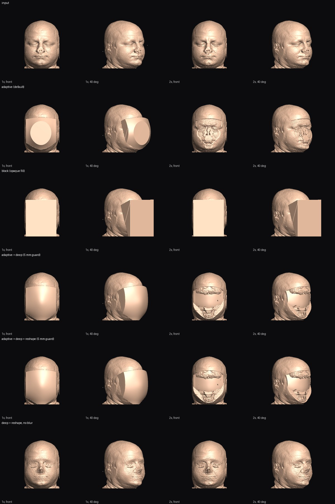

# Prototype: removing the identity left below the skin

Status: `deep` is an opt-in feature on branch
`claude/deep-anonymize-prototype-7c1964`; `reshape` is an experimental opt-in
on top of it. With both off, the region, the modes and the outputs are those
of 0.1.1. Parameters are documented in [parameters.md](parameters.md).

## The problem

`adaptive` rewrites a region whose back wall is the measured skin minus
`skin_depth_mm` (0.07·d, about 4.5 mm). The blur lowers the intensities inside
that shell, so a surface rendered at 2x or 4x the skin threshold lands on the
back wall: the subject's own face, moved 4.5 mm inward. A face recognizer
matches it. Making the shell a few mm thicker only moves that copy.

## Where the depth is set, and what limits it

- `build_face_wall` (`crates/radveil-core/src/deface.rs`) marches every
  (u, v) column of the face frame from the front of the hull to the first
  tissue. The wall is that skin height minus `skin_depth_mm`; the nose and
  lips are cut down to the surrounding skin level, never below the eye-skin
  plane.
- The hull floor `depth_behind_mm` (0.21·d behind the eye-skin plane) clamps
  the wall, so the cheeks' sides are not reached at all.
- Nothing in the geometry knows where the brain is. Safety comes from the
  depth being smaller than the soft tissue (forehead about 5 mm). The brain
  guard is separate: `prepare` (`pipeline.rs`) extracts the brain with the
  Rust SynthStrip, grows it by `brain_guard_mm`, and `mark_roi` skips those
  voxels.
- The self-check re-renders and escalates (blur sigma x1.6, then `block`) by
  re-applying the first plan, so it never reaches deeper than the first mask.

So going deeper is limited by one thing: without the brain mask, any depth
beyond the forehead's soft tissue reaches the frontal lobe.

## What was built

### `deep`: depth-adaptive region (design 1)

`DefaceParams::deep`, Python `deep=True`, CLI `--deep`, C `RADVEIL_DEEP`
(`deep_depth_mm` / `--deep-depth`, auto 0.40·d, about 25 mm; `deep_guard_mm`
/ `--deep-guard-mm`, default 5 mm).

- The wall goes `deep_depth_mm` below the skin, the hull floor moves back by
  the same amount, and the nose is cut down to the hull floor.
- `deep` implies the brain guard, with its own margin `deep_guard_mm`
  (with `brain_guard` on too, the larger margin applies). The guard is now
  built before the plan (`plan_guarded`), and every column is marched from the front and stops in
  front of the first protected voxel. `mark_roi` still skips protected
  voxels, so the guarantee does not rest on the column grid.
- There is no bone detection: bone and air are both dark on MRI. The depth is
  a fixed cap; the guard decides where it stops near the brain.
- Without a protected set (the low-level `Volume.deface`) `deep` does nothing.
- The mask is still the set of rewritten voxels, and escalations re-apply the
  same plan.

### `reshape`: warp onto a generic face (design 2)

`DefaceParams::reshape`, Python `reshape=True`, CLI `--reshape`, C
`RADVEIL_RESHAPE`. Implemented
in Rust (`face_warp`, `warp_face`), applied once, before the mode rewrites
the region.

- Target: `generic_face(x, y)`, a sum of nine smooth bumps on a rounded head,
  in units of the inter-eye distance. The bump centres and widths are set by
  hand; the amplitudes are a least-squares fit, rounded to 0.01, to the mean
  skin height of 40 IXI T1 volumes (other subjects than the evaluated ones;
  2.3 mm RMS from that mean). No per-subject data is stored. A plane (offset
  and two tilts) fitted to the subject's skin places it.
- Warp: in each column the tissue between the wall and the skin is resampled
  (trilinear) to fill the span between the wall and the target. Displacement
  is along the forward axis only, zero at the wall, and fades to zero over
  0.25·d towards the hull's sides and towards columns that cannot move (no
  skin, a field-of-view cut).
- Only masked voxels are written.

The WASM binding does not expose the two flags (it has no brain
extraction).

## Measurement

Attack code: the evaluation paper's `bench/attack.py` (renders at -40…+40°
yaw, iso-surface 0.5x, 1x, 2x, 4x the input's threshold, YuNet alignment,
ArcFace and SFace) and the similarity and rank functions of
`analysis/reid.py`. Gallery: the clean templates of every IXI subject (580
T1 for T2/PD probes, 551 PD-else-T2 for T1 probes; chance about 0.2%).
Alignment: the better of the two oracle alignments per comparison, as in the
paper. Probes: 120 IXI subjects (seed 0) whose T1, T2 and PD the released
`adaptive` accepted; every variant accepted all 360 scans. The 3 mm-guard
and no-blur rows were run on the first 60 subjects only. Driver:
`tools/prototype_deep_eval.py`.

Rank-1 hits / probes. "fused" is the attacker who takes the best depth.

**ArcFace**

| Variant | Probes | 0.5x | 1x | 2x | 4x | fused |
|---|---|---|---|---|---|---|
| clean (control) | T2/PD | 229/240 | 237/240 | 179/240 | 104/240 | 222/240 |
| `adaptive` (default) | T2/PD | 0/240 | 1/240 | 13/240 (5.4%) | 17/240 (7.1%) | 19/240 (7.9%) |
| `block` | T2/PD | 0/240 | 1/240 | 3/240 (1.2%) | 0/240 | 0/240 |
| `adaptive` + `deep`, 5 mm guard | T2/PD | 1/240 | 1/240 | 0/240 | 0/240 | 0/240 |
| `adaptive` + `deep` + `reshape`, 5 mm guard | T2/PD | 0/240 | 1/240 | 0/240 | 0/240 | 0/240 |
| `adaptive` + `deep`, 3 mm guard | T2/PD | 0/120 | 0/120 | 0/120 | 0/120 | 0/120 |
| `adaptive` + `deep` + `reshape`, 3 mm guard | T2/PD | 0/120 | 0/120 | 0/120 | 0/120 | 0/120 |
| `deep` + `reshape`, no blur, no self-check | T2/PD | 3/120 | 1/120 | 4/120 (3.3%) | 7/120 (5.8%) | 7/120 (5.8%) |
| clean (control) | T1 | 116/119 | 119/120 | 120/120 | 95/119 | 118/120 |
| `adaptive` (default) | T1 | 1/119 | 1/120 | 33/120 (27.5%) | 6/119 (5.0%) | 6/120 (5.0%) |
| `block` | T1 | 0/119 | 0/120 | 0/120 | 0/119 | 0/120 |
| `adaptive` + `deep`, 5 mm guard | T1 | 3/119 (2.5%) | 5/120 (4.2%) | 0/120 | 1/119 (0.8%) | 1/120 (0.8%) |
| `adaptive` + `deep` + `reshape`, 5 mm guard | T1 | 0/119 | 0/120 | 0/120 | 2/119 (1.7%) | 2/120 (1.7%) |
| `adaptive` + `deep`, 3 mm guard | T1 | 1/60 | 3/60 (5.0%) | 0/60 | 1/60 | 1/60 |
| `adaptive` + `deep` + `reshape`, 3 mm guard | T1 | 0/60 | 0/60 | 0/60 | 1/60 | 1/60 |
| `deep` + `reshape`, no blur, no self-check | T1 | 1/60 | 5/60 (8.3%) | 9/60 (15.0%) | 16/60 (26.7%) | 14/60 (23.3%) |

**SFace**

| Variant | Probes | 0.5x | 1x | 2x | 4x | fused |
|---|---|---|---|---|---|---|
| clean (control) | T2/PD | 197/240 | 219/240 | 151/240 | 64/240 | 211/240 |
| `adaptive` (default) | T2/PD | 2/240 | 3/240 | 16/240 (6.7%) | 15/240 (6.2%) | 19/240 (7.9%) |
| `block` | T2/PD | 6/240 (2.5%) | 3/240 | 2/240 | 0/240 | 6/240 (2.5%) |
| `adaptive` + `deep`, 5 mm guard | T2/PD | 0/240 | 1/240 | 0/240 | 1/240 | 1/240 |
| `adaptive` + `deep` + `reshape`, 5 mm guard | T2/PD | 0/240 | 0/240 | 0/240 | 0/240 | 0/240 |
| `deep` + `reshape`, no blur, no self-check | T2/PD | 4/120 | 4/120 | 2/120 | 5/120 (4.2%) | 5/120 (4.2%) |
| clean (control) | T1 | 106/119 | 115/120 | 114/120 | 67/119 | 116/120 |
| `adaptive` (default) | T1 | 0/119 | 0/120 | 23/120 (19.2%) | 5/119 (4.2%) | 6/120 (5.0%) |
| `block` | T1 | 0/119 | 0/120 | 0/120 | 0/119 | 0/120 |
| `adaptive` + `deep`, 5 mm guard | T1 | 0/119 | 0/120 | 0/120 | 1/119 | 1/120 |
| `adaptive` + `deep` + `reshape`, 5 mm guard | T1 | 0/119 | 0/120 | 0/120 | 1/119 | 1/120 |
| `deep` + `reshape`, no blur, no self-check | T1 | 0/60 | 4/60 (6.7%) | 15/60 (25.0%) | 11/60 (18.3%) | 12/60 (20.0%) |

**Brain contact, tissue, time**

| Variant | IXI scans touching the Rust SynthStrip mask | SynthStrip-set scans touching the expert mask | Median tissue changed | Median time |
|---|---|---|---|---|
| `adaptive` (default) | 4 of 360 | 0 of 201 | 65 ml | 0.28 s |
| `block` | 4 of 360 | 0 of 201 | 65 ml | 0.19 s |
| `adaptive` + `brain_guard` | not run | 0 of 201 | not run | not run |
| `adaptive` + `deep`, 3 mm guard | 0 of 180 | **4 of 201** (6, 7, 8 and 229 voxels) | 285 ml | 2.9 s |
| `adaptive` + `deep` (+ `reshape`), 5 mm guard | 0 of 360 | 0 of 201 | 263 ml | 2.9 s |
| `deep` + `reshape`, no blur | 0 of 180 | as `deep`, 3 mm | 256 ml | 2.7 s |

- The 201 SynthStrip-set scans are the ones the released `adaptive` accepted;
  contact there is counted on the planned region (`anonymization_mask`),
  which is also the final mask.
- Tissue is the paper's definition: changed voxels above 10% of the 99th
  percentile, compared in memory.
- Time is `deface_volume` in memory on 12 IXI volumes, one at a time, 14
  cores, without load, save or `brain_check`. The 2.7 s difference is the
  brain extraction.
- Voxels outside the returned mask were bit-exact on every scan of every
  variant.
- The self-check escalated to the opaque fill on 26 of 360 scans for
  `adaptive`, 6 for `deep` and 5 for `deep` + `reshape` (5 mm guard).

**MRHead** (3D Slicer's public sample), 1x and 2x depth:

## What did not work

- **The warp on its own.** Moving the tissue onto the generic face without
  blurring gives a natural-looking head, and it is the only variant here that
  does. It is still identifiable: 5.8% (T2/PD) and 23% (T1) fused ArcFace
  rank-1 on 60 subjects, worse than `adaptive` at 4x. The warp moves tissue
  only along the forward axis. Eye spacing, nose and mouth width, and the
  skin and fat texture stay where they were, and a recognizer reads them.
  The self-check also has to be off, because the output is a face by design.
- **`deep` alone at the skin surface, on full-face T1 probes.** The deeper
  surfaces are clean, but at 0.5x and 1x ArcFace finds 3/119 and 5/120 (3/60
  at 1x with the 3 mm guard too), against 1/120 for `adaptive`. A 25 mm slab
  blurred with a 10 mm kernel keeps a low-frequency relief of the face.
  Adding `reshape` removes it (0/119, 0/120): the relief that is blurred is
  then the generic one.
- **A 3 mm brain margin for `deep`.** The region never touched the Rust
  SynthStrip mask, but that mask and the expert mask differ by more than 3 mm
  in places: 4 of 201 scans touch the expert mask (two IXI T2, two 5 mm-slice
  QIN T2; at most 229 voxels, 5.4 mm inside the expert mask). With 5 mm,
  none do, so `deep` now has its own margin, `deep_guard_mm`, defaulting to
  5 mm. The measurements above used `brain_guard_mm=5`, which builds the
  same protected set.
- **A natural-looking result.** Every variant that reaches the opaque fill's
  re-identification level looks like `adaptive` does: a smooth blob over the
  face region. Design (3), replacement with average-face tissue, was not
  built.

## Against the target

Target: 2x and 4x re-identification close to the opaque fill (about 1% or
less), zero contact on the expert-masked scans.

- `adaptive` + `deep` + `reshape` with a 5 mm guard: ArcFace 2x 0/240 and
  0/120, 4x 0/240 and 2/119 (1.7%); SFace at most 1/119; fused at most
  2/120; expert-mask contact 0 of 201. It meets the target on T2/PD probes
  and is at its edge on T1 probes at 4x. Two hits in 119 has a 95% interval
  of roughly 0.2% to 6%, so this sample cannot separate it from `block`
  (0/119).
- The price is about four times the changed tissue (263 ml against 65 ml),
  which includes the eyes, the nasal cavity and the front of the mouth, plus
  2.7 s and about 3 GB for the brain extraction.

## Recommendation

Develop `deep` + `reshape` together, as one option, with these changes:

1. Give `deep` its own guard margin with a 5 mm default, instead of sharing
   `brain_guard_mm`. (Done: `deep_guard_mm`.)
2. Re-run on the full IXI cohort (the T1 4x cell needs more than 120 probes)
   and on the full SynthStrip set, including downstream skull-stripping and
   segmentation, since the edit is four times larger.
3. Treat the natural look as a separate piece of work. The warp shows the
   geometry can be made generic at every depth, but texture and lateral
   layout carry identity; that needs design (3), or a warp that also moves
   tissue across the face, and a self-check that does not rely on "no face
   found".

`reshape` without `deep`, and `reshape` without a blur, should not be offered.
